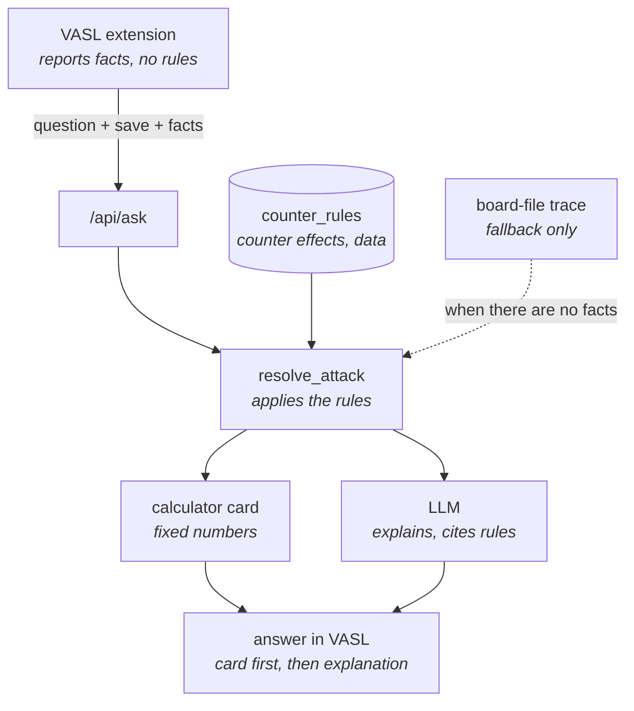

# VASL "Ask LLM" extension

The extension (`vasl-extension/`, a VASSAL `.vmdx` for VASL) adds an **Ask LLM**
button to VASL. A question goes to ruleschat's `/api/ask/stream` together with
a snapshot of the game and what VASL's own map model knows about the attack
being asked about. The server does the rules math; the model explains it.



In words:

1. **The VASL extension** sends the question, the save and the facts it read
   from VASL's map to `/api/ask`.
2. **`resolve_attack`** turns them into FP, column, DRM and odds. It looks up
   what each counter does in **`counter_rules`**, and uses the **board-file
   trace** only when there are no facts.
3. The result becomes the **calculator card** (fixed numbers) and goes to the
   **LLM**, which explains it and cites the rules.
4. **The answer in VASL** shows the card first, then the explanation.

The split is deliberate:

- **The extension is the sensor.** It runs inside VASL, where the live map
  already has overlays, SSR terrain changes, counters and levels applied, and
  VASL's own LOS engine. It reports what it sees and interprets nothing.
- **The server is the rules engine.** `resolve_attack` turns facts into FP,
  column, DRM and odds. What each counter *does* lives in one data table.
- **The model is the explainer.** It never re-derives the numbers.

---

## 1. The payload

`POST /api/ask/stream` with `Authorization: Bearer <ruleschat API key>`.

A fire question ("W6 fires at T4 – IFT and DRM?") from extension 0.6.1, during
Prep Fire, with a roadblock in U5. Lists of hexsides are shown for one hex only;
every hex in `facts.hexes` carries all six.

```jsonc
{
  "question": "W6 fires at T4 - what is the IFT and DRM?",
  "rich": true,                         // extension >= 0.4: wants calculator_html
  "vsav": "data:application/octet-stream;base64,UEsDBBQ...",   // whole game save
  "side": "German",                     // perspective for fog of war
  "player": "Kevin",                    // VASSAL display name (maps to a side)
  "model": "claude-fable-sub",          // registry key; server may override
  "game_phase": "PFPh",                 // VASL phase wheel: PFPh/MPh/DFPh/AFPh
  "history": [                          // last <= 6 [question, answer] pairs
    ["S3 fires at W4 - IFT and DRM?", "The 5-4-8 attacks on the 4 FP column..."]
  ],

  // Present when the question names two hexes. The first is the firer, the
  // second the target ("S3 fires at V4"; "41-S3" for a multi-board map).
  "native_los": {
    // --- chosen by the extension: which two Locations to check ---
    "source": "W6",                     // first hex named in the question
    "target": "T4",                     // second hex named in the question
    "source_location": "W6",            // VASL Location name ("M2 Level 1" for
    "target_location": "T4",            //   a building's first floor)
    "source_from_units": true,          // Location of the visible units there;
    "target_from_units": true,          //   false = none visible: ground level
    "source_level": 0,                  // level WITHIN the hex (0 = ground),
    "target_level": 0,                  //   not elevation: a hill hex is still 0

    // --- straight from VASL's LOS engine (LOSResult) ---
    "blocked": false,
    "reason": "",                       // VASL's text when blocked
    "hindrance": 1,                     // total hindrance DRM VASL counted
    "range": 3,

    // --- extension >= 0.5: what VASL's map model knows (raw facts) ---
    "facts": {
      "source_height": 0,               // absolute heights (hill + level in hex)
      "target_height": 0,
      "source_terrain": "Paved Road",   // terrain at each Location as on the map
      "target_terrain": "Paved Road",   //   now (overlays/SSR applied)
      "source_base": 0,
      "target_base": 0,

      "path": [                         // hexes crossed, firer -> target
        {"hex": "V5", "base": 0, "terrain": "Paved Road", "counters": []},
        {"hex": "U5", "base": -1, "terrain": "Shallow Stream", "counters": []}
      ],
      "target_counters": ["vehicle: PzKw IIA vca3 tca2 BU"],
                                        // SMOKE / vehicles / wrecks VASL counts

      "target_entry": {                 // the hexside the LOS enters the target by
        "neighbor": "U5", "side": 2, "terrain": ""   // "Wall", "Hedge", ...
      },
      "first_hindrance_hex": "U5",      // where VASL found the first hindrance
      "blocked_at_hex": null,           // where VASL blocked the LOS, if it did

      // --- extension >= 0.6: every non-unit counter, uninterpreted ---
      "hexes": [
        {"hex": "W6", "role": "firer",  "base": 0,  "terrain": "Paved Road",
         "sides": ["..."], "counters": [{"name": "Prep Fire", "side": -1,
                                        "angle": null, "arrow_level": null}]},
        {"hex": "V5", "role": "path",   "base": 0,  "terrain": "Paved Road",
         "sides": ["..."], "counters": []},
        {"hex": "U5", "role": "path",   "base": -1, "terrain": "Shallow Stream",
         "sides": [
           {"side": 0, "bearing": 0,   "neighbor": "U4", "hexside_terrain": "", "location_terrain": "Shallow Stream"},
           {"side": 1, "bearing": 60,  "neighbor": "V4", "hexside_terrain": "", "location_terrain": "Open Ground"},
           {"side": 2, "bearing": 120, "neighbor": "V5", "hexside_terrain": "", "location_terrain": "Paved Road"},
           {"side": 3, "bearing": 180, "neighbor": "U6", "hexside_terrain": "", "location_terrain": "Shallow Stream"},
           {"side": 4, "bearing": 240, "neighbor": "T5", "hexside_terrain": "", "location_terrain": "Open Ground"},
           {"side": 5, "bearing": 300, "neighbor": "T4", "hexside_terrain": "", "location_terrain": "Paved Road"}
         ],
         "counters": [
           {"name": "Roadblock",                 // counter's VASSAL name
            "side": -1,                          // hexside it sits on, -1 = in the hex
            "angle": -120.0,                     // VASSAL FreeRotator angle
            "arrow_level": null}                 // DO roadblock "Arrow" layer (1 down, 2 up)
         ]},
        {"hex": "T4", "role": "target", "base": 0,  "terrain": "Paved Road",
         "sides": ["..."], "counters": []}
      ]
    }
  }
}
```

### When `native_los` is sent

The extension builds `native_los` (and its `facts`) itself, before the
request leaves VASL. The LLM plays no part. It does so when:

1. a game is open with a map loaded;
2. the question names two hexes. The `HEX_REFERENCE` regex takes the first
   two matches ("S3", or "41-S3" on multi-board maps; rule numbers such as
   "A7.22" are skipped), the first as firer and the second as target. Any
   further hexes are ignored;
3. they are different hexes that both exist on the map (if not, it gives up;
   it doesn't try later matches);
4. VASL's LOS check runs without error.

It does this for every such question, not only fire questions. The server
decides relevance: a fire question (a second regex on words such as fire,
attack, IFT, DRM, odds) gets the calculator run on that pair; any other
question just passes VASL's verdict to the model as context.

Known weak spots: word order is the only signal for firer vs target ("V4 is
fired on by S3" checks V4 → S3), and rule names without a decimal ("E4") can
look like hexes.

### Where `facts` come from

Everything in `facts` is read from VASL's live map model at the moment you
ask: the same model VASL's LOS tool uses, so overlays, SSR terrain changes and
counters are included.

| Facts | VASL source |
|---|---|
| heights, terrain at firer/target | the two `Location`s (`getAbsoluteHeight`, `getTerrain`) |
| base levels, hexsides, neighbors | `Hex` (`getBaseLevelofHex`, `getHexsideTerrain`, `getHexsideLocation`, `Map.getAdjacentHex`) |
| `path`, `target_entry` | the LOS line between the two Locations, walked over the map with `Map.gridToHex` |
| SMOKE / vehicles / wrecks per hex | `VASLGameInterface.getSmoke` / `getVehicles` / `getWreck` |
| `first_hindrance_hex`, `blocked_at_hex` | VASL's `LOSResult` (`firstHindranceAt`, `getBlockedAtPoint`) |
| counters in `hexes` | the game's pieces: name, position (hexside or not), `FreeRotator` angle, `Arrow_Level` layer |
| which Location in each hex | `VASLGameInterface.getLocation(unit)` for the visible units there |

### Field reference

| Field | From | Notes |
|---|---|---|
| `question` | text box | ≤ 4,000 chars. Hexes named in it pick the attack pair. |
| `vsav` | VASL's live game, saved to bytes | The server parses units, markers, boards and SSRs from it (`app/services/vsav_service.py`). Sent when "Attach board" is on. |
| `side` / `player` | VASL player roster / VASSAL display name (`RealName` pref) | Fog of war: the server hides the other side's concealed/HIP units. "Solo: full view" sends neither. The VASSAL password pref (`getUserId`) is never sent. |
| `model` | Settings dropdown | Non-admin keys fall back to the server default; subscription models are admin-only. |
| `game_phase` | phase wheel | Maps to the fire phase (`PFPh` → Prep, `MPh` → Defensive First, `DFPh` → Final, `AFPh` → Advancing). |
| `history` | transcript | Context only; `/api/ask` is stateless. |
| `native_los.source/target` | question text | The first two hexes named; the extension doesn't guess from the map. |
| `native_los.*_location`, `*_from_units` | `VASLGameInterface.getLocation(unit)` | LOS is checked from where the units actually are: the Location holding most of the hex's visible units (ties to the higher level), e.g. a building's first floor. With no visible units (empty hex, or only concealed/HIP enemies, which are never consulted) it falls back to the hex's ground level. |
| `native_los.blocked/reason/hindrance/range` | `Map.LOS(...)` → `LOSResult` | The verdict from VASL's own LOS engine, same as VASL's LOS tool (it ignores roadblocks; see below). |
| `facts.*_height` | `Location.getAbsoluteHeight()` | Absolute levels (hill + building level) of those Locations: use these, not `*_level`. The resolver uses them for the PBF level test (A7.21) and walls/roadblocks (B9.2). |
| `facts.target_entry` | LOS line + `Hex.getHexsideTerrain(side)` | Decides hexside TEM (B9.3) at the target. |
| `facts.path[].counters` | `VASLGameInterface.getSmoke/getVehicles/getWreck` | What VASL counts as hindrances, per hex. |
| `facts.first_hindrance_hex` | `LOSResult.firstHindranceAt()` | Names the hindrance when nothing else explains it. |
| `facts.hexes[].counters` | every piece in the hex | Units and anything invisible/obscured to this player are never sent. |
| `facts.hexes[].sides` | `Hex.getHexsideLocation/getAdjacentHex/getHexsideTerrain` | `bearing`: 0 = up, clockwise. Lets the server turn a counter's arrow into a hexside. |

Older extensions send less, and the server copes: 0.3 sends no `facts`;
0.5 sends `facts` without `hexes` (with a pre-digested `roadblocks` list
instead); before 0.6.1 the LOS was always checked from each hex's ground
level, and `*_location` / `*_from_units` are missing.

---

## 2. The response stream

NDJSON, one JSON object per line, in this order:

| Line | Meaning |
|---|---|
| `{"calculator_html": "<table…>"}` | The calculator card: firers, column, DRM line items, odds. Rendered by the server as Swing-safe HTML 3.2 and shown above the answer. Fire questions only. |
| `{"status": "Resolving the attack from the save file"}` | Progress: tool being run, repeated at least every 10 s (keeps nginx's 60 s timeout from cutting the stream). |
| `{"delta": "…"}` | Answer text (markdown). |
| `{"error": "…"}` | Mid-stream failure; the stream ends. |
| `{"done": true, "model": …, "elapsed_seconds": …, "tokens_in": …, "tokens_out": …, "cost_usd": …, "remaining_today": …}` | Final metadata line. |

Errors before the stream starts (bad key, daily limit, unreadable save) are
ordinary HTTP errors with `{"detail": "…"}`.

The answer text follows a fixed format (`ASK_ANSWER_FORMAT` in
`app/api/ask.py`): one sentence, at most three rule-cited bullets, then
`Assumptions:` and `Rules:` sections that the extension folds behind
"▸ 3 assumptions · ▸ 5 rules cited".

---

## 3. What the server does with it

1. **Parse the save** (`vsav_service.parse_vsav`) → units, markers, boards,
   SSR transforms, overlays; mask hidden units for the requesting side.
2. **Precompute the attack** when the question is a fire question and
   `native_los` names the pair (`_precompute_attack` in `app/api/ask.py`).
   `resolve_attack` runs the rule pipeline (`app/asl/attack/pipeline.py`):
   an ordered list of small steps that derive LOS, range, PBF, firers, TEM
   and DRM, then IFT odds via `app/asl/ift.py`. See section 5.
3. **Prefer VASL's facts** (`_apply_vasl_facts`): target hexside TEM from
   `target_entry`, heights, hindrance sources, and counter effects from
   `counter_rules`. Without facts, `board_terrain.py` traces the board files
   instead (fallback: no overlays, no counters).
4. **Render the card** (`_calculator_html`) and stream it first.
5. **Ask the model** with the full resolution marked authoritative: explain
   each line, cite rules, relay assumptions. It must not recompute the numbers.

If VASL reports the LOS blocked, there is no attack: the card says so and
names the obstacle, using `blocked_at_hex` plus a terrain trace.

---

## 4. Counter rules: where edge cases go

`app/asl/counter_rules.py` is the single table of what a counter does. Each
counter in `facts.hexes` is classified, first match wins:

| Kind | Meaning | Examples |
|---|---|---|
| `hexside_wall` | Wall-like hexside obstacle VASL's LOS ignores: TEM when the LOS enters the target across it; a Half-Level Obstacle to same-level LOS elsewhere (B9.2) | Roadblock (B29) |
| `handled` | The resolver already reads it from the save | Foxhole, Trench, concealment `?` |
| `no_effect` | No effect on LOS or TEM | Prep Fire, CX, Pin, Wire, minefields |
| `vasl_los` | VASL's LOS engine already counts it (`data/vasl_counter_metadata.json`, from VASL's `CounterMetadata.xml`) | SMOKE, WP, wrecks, blazes, rubble, bridges, crests |
| `unmodeled` | Anything else | Pillbox, … |

`unmodeled` counters on the LOS or in the target hex are listed in the answer
as **not modelled — check**, so a new edge case shows up the first time it
appears instead of being silently ignored.

**A counter edge case is a row in `COUNTER_RULES` plus a test** in
`tests/test_attack_resolver.py`, not new code in the extension. A rules edge
case goes in the pipeline (next section).

A hexside counter's hexside comes from where it sits (`side >= 0`), otherwise
from its arrow. Roadblock art points **down** at rotation 0, and VASSAL draws
`FreeRotator` at −angle, so the arrow's bearing is `arrow_base − angle`
(`arrow_base` 180; 0 when a DO roadblock's Arrow layer is set to up). The
road hexside is preferred as a tie-break (B29.1).

---

## 5. The rule pipeline: where rule fixes go

`resolve_attack` is an explicit, ordered list of steps
(`STEPS` in `app/asl/attack/pipeline.py`). Each step is a function
`step(ctx)` in `app/asl/attack/steps/` that reads the shared
`AttackContext`, adds DRM lines, caveats or warnings, or raises `NoAttack`
(a `ValueError`) when there is no legal attack:

| Group | Steps (in order) |
|---|---|
| LOS | `locate`, `vasl_verdict`, `measure_range`, `walls`, `grid_trace`, `vasl_facts`, `overlays` |
| Firers | `firing_side`, `eligible_firers`, `point_blank`, `fire_strength`, `leadership` |
| Target | `target_units`, `concealment` |
| DRM ledger | `hindrance`, `tem`, `firer_modifiers`, `ffmo_ffnam`, `encircled_target` |
| Odds | `cowering`, `target_morale`, `skis`, `odds` |

- **The order is the contract:** a step may rely only on what earlier steps
  set (`tests/test_attack_pipeline.py` pins the key dependencies), and the
  card shows warnings, caveats and DRM lines in step order.
- **Caveats are keyed:** the six standing caveats (`los`, `hindrance`,
  `overlays`, `entrenchment`, `levels`, `fire_group`) are replaced by name
  (`ctx.caveats.set("hindrance", ...)`), never by list position.
- **Adding a rule:** write a step, or extend the one that owns the rule, and
  put it where its inputs are ready (e.g. Wall Advantage, B9.32, between
  `walls` and `tem`), plus a test. Shared helpers and rule tables (unit
  classification, geometry, TEM values) still live in
  `app/asl/attack_resolver.py`.

---

## 6. Eval cases: "Save as eval case"

Under each answer the extension (>= 0.7) shows **Save as eval case**. It
asks for an optional note ("what's wrong") and re-sends the original request
(including the save), the answer and the note to `POST /api/ask/cases`.
Admin keys only.

The server stores each case on prod, never in git (`.gitignore`):

```
data/ask_cases/<id>/case.json   question, VASL facts, answer, note, extension version,
                                expected / expected_answer (filled in when it becomes an eval)
data/ask_cases/<id>/save.vsav   the game save, as sent
```

**`/admin/ask-cases`** lists them. Each case page shows the board, drawn from
the stored save by the same viewer as the chat page, plus:
- your note and the answer as captured;
- **the calculator re-run with today's code** on the same save and facts,
  so after a fix you can see whether the case now comes out right;
- the VASL facts, and downloads of `case.json` / `save.vsav` (for the evals
  repo's sync).

Saves hold both sides' units, hidden ones included, so cases stay admin-only.

---

## 7. Building, installing, debugging

- **Build:** `vasl-extension/build.sh` → `dist/AskRuleschat-<version>.vmdx`.
  It compiles against the local VASSAL and VASL jars with `--release 11`. Bump
  the version in `AskRuleschatButton.java`, `buildFile.xml` and `extensiondata`.
- **Install:** close VASL, remove the old extension in the Module Manager, add
  the new `.vmdx`, relaunch. Extensions load only at module start.
- **When an answer looks wrong:** prod logs every request's facts. Check them
  first:
  `ssh mydigitalocean 'journalctl -u uvicorn.service --since "-1 hour" | grep "VASL LOS facts"'`.
  They show what VASL saw (terrain, hexsides, counters, roadblock angle), which
  separates a sensing problem (extension) from a rules problem (resolver or
  table).
- **Tests:** `tests/test_ask_api.py` (endpoint, card, stream),
  `tests/test_attack_resolver.py` (resolver, facts, counter rules).
